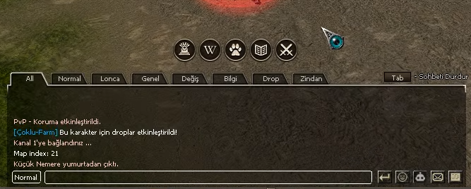

# Chat Tabs & Whisper Messenger

Sohbet sekmeleri ve yeni fısıltı penceresi. 8 sohbet sekmesi (zindan, takas, düşen eşya dahil), sohbet listesi tarzı fısıltı, emoji seçici ve arkadaş detayları.



---

## Ne var?

- 8 sohbet sekmesi, yeni sohbet türleri: zindan / takas / düşen eşya
- Fısıltı mesajlaşma penceresi (`uiwhispermessenger.py`)
- Yeni arkadaş listesi (`uimessengerrenewal.py`) ve arkadaş detayları
- Emoji seçici (`uiemojipicker.py`)
- Panoya kopyalama (`app.SetClipboardText`)

## Paket yapısı

```
01. Svn/          → Client & Game source (Ara / Altına ekle / Bul / Değiştir patch dosyaları + yeni dosyalar)
02. Client/       → root, uiscript, locale, d_/ymir work assetleri
Added/            → Değişikliklerin uygulanmış hali (tam dosyalar, karşılaştırma için)
```

## Flagler

**Client** (`Locale_inc.h`):
- `ENABLE_WHISPER_MESSENGER`
- `ENABLE_MESSENGER_DETAILS`
- `ENABLE_CHAT_TABS`
- `ENABLE_CLIPBOARD_TEXT`

**Game** (`service.h`):
- `ENABLE_CHAT_TABS`
- `ENABLE_MESSENGER_DETAILS`

Client ve game tarafında aynı isimli flagler birlikte açık olmalı; tek taraf açıkken paket / komut uyumsuzluğu olur.

## Kurulum (kısaca)

1. `01. Svn` altındaki patch dosyalarını kendi source ağacına uygula. Her blokta `// Ara:` satırlarını bul, `// Altına ekle:` kısmını altına ekle; `// Bul:` / `// Degistir:` bloklarında bulduğun satırları verilen blokla değiştir.
2. Yeni dosyaları (`messenger_details.cpp`, `messenger_details.h`) ilgili klasöre kopyala; game için `Makefile`, client için `vcxproj.txt` notuna göre projeye ekle.
3. `02. Client/root` ve `02. Client/uiscript` içindeki tam dosyaları pack'e kopyala, patch dosyalarını (`# Ara:` / `# Altına ekle:`) kendi dosyalarına uygula.
4. `02. Client/locale/<dil>/` satırlarını kendi locale dosyalarının sonuna ekle.
5. `02. Client/d_/ymir work/` görsellerini pack'e ekle (`d:/ymir work/...`).
6. Client + game + db rebuild, pack güncelle.

## Bağımlılıklar

- `uicharacterdetails.py` (karakter detay penceresi)
- Ülke bayrağı görselleri (`ui/language_system/flags/`)
- `advanced_options_runtime.py` patch'i yalnızca **Advanced Game Options** paketi kuruluysa gerekli.
- `uiadvancedgameoptions.py` patch'i yalnızca **Advanced Game Options** paketi kuruluysa gerekli.
- `uibiologist.py` patch'i yalnızca **Biologist System Renewal** paketi kuruluysa gerekli.
- `uiguildrenewal.py` patch'i yalnızca **Guild Window Renewal** paketi kuruluysa gerekli.
- `uiwardrobe.py` patch'i yalnızca **Wardrobe & Costume Shop System** paketi kuruluysa gerekli.

## Notlar

- Locale dosyalarında yalnızca bu sisteme ait anahtarlar var; `new_locale_*` kendi eklediğimiz, `locale_game` / `locale_interface` resmi istemcide olmayan anahtarlar. Türkçe dosyalar cp1254.
- Patch'lerde başka sistemlere ait satırlar görürsen (farklı `#ifdef`), o sistem sende yoksa yok say.
- Fork farklıysa paket header / struct sıralamasını kontrol et.

---

## İletişim

Sorular için Discord'dan yazabilirsin.

| | |
|---|---|
| GitHub | [github.com/ybeststudio](https://github.com/ybeststudio) |
| Discord | [discord.gg/NXmc6JrwYr](https://discord.gg/NXmc6JrwYr) |
| Discord ID | `beststudio` |
| Web | [bestpro.dev](https://bestpro.dev) |
| TurkMMO | [Best Studio](https://forum.turkmmo.com/uye/2104546-best-studio/) |
| YouTube | [@ybeststudio](https://www.youtube.com/@ybeststudiotr) |
| Instagram | [@ybeststudio](https://www.instagram.com/ybeststudio) |
| Facebook | [ybeststudio](https://www.facebook.com/ybeststudio/) |
| Twitter | [@ybeststudio](https://twitter.com/ybeststudio) |
| TikTok | [@ybeststudio](https://tiktok.com/@ybeststudio) |

---

**Best Studio** — Metin2 private server çözümleri
